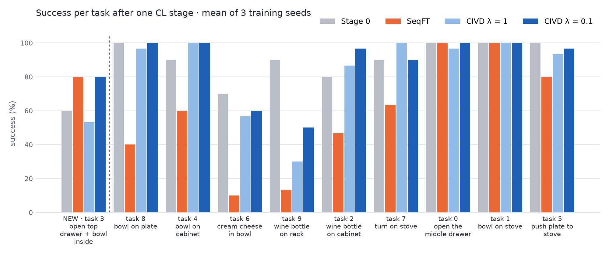

# Continual Learning for Vision-Language-Action Models

Code for a study of **continual learning (CL)** in a small **vision-language-action (VLA)** robot policy, written for the FPT Frontier Lab FFI26 take-home assignment. Author: Lôi Đình Nhất, November 2026.

## Background

### The problem

A VLA model takes camera images, the robot's state and a natural-language instruction ("put the bowl on the plate"), and outputs robot actions. Such models are trained once on a fixed set of demonstrations. A deployed robot, however, keeps receiving new tasks.

Fine-tuning the model on each new task is the obvious approach, called **sequential fine-tuning (SeqFT)**. It causes **catastrophic forgetting**: the model gets better at the new task and loses skills it already had.

**Continual learning** asks how to learn new tasks (*plasticity*) without losing old ones (*stability*). Ideally this works without storing old training data, which costs memory and may be private, and without growing the model.

### The model and the benchmark

- **[SmolVLA](https://arxiv.org/abs/2506.01844)** (0.45B parameters, Hugging Face, 2025) is a small open VLA. A pretrained vision-language model encodes the images and the instruction. A separate **action expert**, trained with **flow matching**, generates a chunk of 50 future actions.
  - Flow matching learns a *velocity field* `v(x_t, t | observation, instruction)` that transports Gaussian noise to an action chunk in 10 integration steps.
  - It plays the role that denoising plays in diffusion policies.
- **[LIBERO](https://arxiv.org/abs/2306.03310)** is a simulated manipulation benchmark (MuJoCo) built for lifelong robot learning. It has four suites of 10 tasks each: Spatial, Object, Goal and Long.
  - In **LIBERO-Goal**, all 10 tasks share one scene and differ only in the instruction, such as "open the middle drawer" or "put the bowl on the stove".
  - That property is what my method exploits.

### What I did

1. **Reproduce.** I evaluated the released SmolVLA LIBERO checkpoint with the released LeRobot code on all four suites (10 episodes × 10 tasks each).
2. **Analyse.** I labelled every failed trajectory to see *how* SmolVLA fails, and *what* forgetting looks like after SeqFT.
3. **Improve.** I propose **CIVD (Cross-Instruction Velocity Distillation)**, a CL method for flow-matching VLAs that stores **no old demonstrations**.

### CIVD in one picture

When the model learns a new task, CIVD keeps a frozen copy of the previous model (the *teacher*). It adds one term to the training loss:

```
L = L_flow-matching(new-task batch)
    + λ · ‖ v_student(x_t, t, o, ℓ_old) − v_teacher(x_t, t, o, ℓ_old) ‖²
```

- `o` are the observations of the **current new-task batch**.
- `ℓ_old` is the instruction of a randomly chosen **old task**. Only the text is stored, not the demonstrations.
- `x_t` is built from an action chunk the teacher samples for `(o, ℓ_old)`.

**Why no old data is needed.** In a shared scene, a new-task observation is also a valid observation for an old task. Asking the student to keep the teacher's velocity field under the old instructions on these observations therefore preserves the old behaviours.

**Novelty.** Output distillation itself is not new (LwF, M2Distill). The new element is the **cross-instruction pairing**, which makes distillation exemplar-free for a flow-matching VLA. My ablation shows this pairing is what does the work.

## Main results

| Experiment | Result |
|---|---|
| **Reproduce** SmolVLA (`lerobot/smolvla_libero`, n_action_steps 10) | **83.3 %** average vs 87.3 % in the paper. Goal 88 (paper 92) and Long 76 (71) match; Spatial 82 (90) and Object 87 (96) are 8–9 pp lower |
| **One CL stage** (stage-0 model learns LIBERO-Goal task 3 for 1200 steps; 9 old tasks evaluated; 3 training seeds) | Old-task success 91 % → **57 % with SeqFT** vs **88 % with CIVD (λ = 0.1)**. Forgetting 34.1 ± 2.8 vs **3.0 ± 2.3 pp** (Fisher p = 3·10⁻¹⁶). **New task: 24/30 for both**, so CIVD keeps the full new-task gain |
| Strength of the constraint | Retention is flat in λ (74–81/90 from λ = 1 to 0.03). At λ = 1 the new task is not learned (16/30); λ = 0.1, chosen on seed 1000, held on two fresh seeds |
| Ablation: distil with the **new** instruction instead (LwF-style) | Forgets like SeqFT over 2 seeds (102 vs 100/180), far more than CIVD (153/180, p = 4·10⁻⁹). The cross-instruction pairing is the active ingredient |
| Against replay | Storing 1 or 5 demos per old task also retains old tasks (Replay-1 78/90, Replay-5 79 · 76) but gives no new-task gain (6–7/10). Exemplar-free CIVD λ = 0.1 matches Replay-5's retention and keeps the gain |
| Cost of CIVD | 9 stored instruction strings, 1.8× training time per step, +2.1 GB GPU memory (teacher); inference unchanged |



All numbers use 10 episodes per task and evaluation seed 1000. All experiments ran on free Kaggle sessions (2× NVIDIA T4).

## Detailed results

### 1. Reproduction on LIBERO

`lerobot/smolvla_libero` (paper configuration), n_action_steps 10. Cells are successes out of 10 episodes.

| Suite | T0 | T1 | T2 | T3 | T4 | T5 | T6 | T7 | T8 | T9 | This work (95 % Wilson CI) | Paper |
|---|---|---|---|---|---|---|---|---|---|---|---|---|
| Spatial | 10 | 9 | 10 | 10 | 8 | **1** | 9 | 8 | 7 | 10 | 82 % (73–88) | 90 % |
| Object | 9 | 10 | 8 | 7 | 8 | 6 | 10 | 9 | 10 | 10 | 87 % (79–92) | 96 % |
| Goal | 10 | 10 | 8 | **6** | 9 | 10 | 7 | 9 | 10 | 9 | 88 % (80–93) | 92 % |
| Long | **4** | 9 | 9 | 10 | 5 | 10 | 5 | 9 | 6 | 9 | 76 % (67–83) | 71 % |
| **Average** | | | | | | | | | | | **83.3 %** | **87.3 %** |

- **Goal and Long match the paper:** the paper's score lies inside my 95 % CI.
- **Spatial and Object are 8–9 pp lower.** Likely causes are a public checkpoint that may differ from the paper model, bf16 weights on a T4 (no native bf16), and 360² rendering vs 256² training images.
- **Spatial task 5 fails reproducibly** (1/10 in two independent runs).
- **A second public checkpoint does worse:** `HuggingFaceVLA/smolvla_libero` (all VLM layers, 0.5× expert, n_action_steps 1) reaches only 76 % (67–83) on Goal.
- **Long action chunks hurt (Goal tasks 0 and 9).** Executing 1 / 10 / 50 actions per chunk gives 80 / 90 / 30 % and 50 / 30 / 10 %, consistent with the paper's Table 13.

### 2. Failure analysis (18 failed episodes, LIBERO-Goal)

| Failure type | Count |
|---|---|
| Sub-task 1 never completed (two-step task 3: drawer never opened) | 8 |
| Grasp miss, continues empty-handed | 4 |
| Knocks the object over | 2 |
| Imprecise placement or push | 2 |
| Sub-task 2 failed | 1 |
| Stuck | 1 |
| **Wrong object or wrong goal** | **0** |

SmolVLA fails on sub-task chaining and grasping, never on instruction grounding. Every failure runs to the time limit, with no closed-loop recovery.

After SeqFT, forgetting looks like **motor degradation, not behaviour overwrite**. The policy still goes to the right object, but fails to release it: 5 of 5 failures on "put the bowl on the plate".

### 3. One CL stage, 3 training seeds

Setup:
- **Stage 0:** `lerobot/smolvla_libero`, which already knows all 10 Goal tasks.
- **Stage 1:** learn Goal task 3 (36 demos) for 1200 steps × batch 16, training only the action expert.
- **Evaluation:** the new task and all 9 old tasks.

Cells are successes out of 30: 3 training seeds (1000, 2000, 3000) × 10 episodes.

| Task | Stage 0 (/10) | SeqFT | CIVD λ = 1 | **CIVD λ = 0.1** | p (λ = 0.1 vs SeqFT) |
|---|---|---|---|---|---|
| **3 (new)** drawer + bowl inside | 6 | **24** | 16 | **24** | 1 |
| 8 bowl → plate | 10 | 12 | 29 | **30** | 2·10⁻⁷ |
| 4 bowl → cabinet top | 9 | 18 | 30 | **30** | 1·10⁻⁴ |
| 6 cream cheese → bowl | 7 | 3 | 17 | **18** | 9·10⁻⁵ |
| 9 wine bottle → rack | 9 | 4 | 9 | **15** | 0.005 |
| 2 wine bottle → cabinet top | 8 | 14 | 26 | **29** | 2·10⁻⁵ |
| 7 turn on stove | 9 | 19 | **30** | 27 | 0.03 |
| 0 open middle drawer | 10 | 30 | 29 | 30 | 1 |
| 1 bowl → stove | 10 | 30 | 30 | 30 | 1 |
| 5 push plate → stove | 10 | 24 | 28 | **29** | 0.10 |
| **Old tasks** (per seed) | **82/90** | 154/270 (49 · 51 · 54) | 228/270 (74 · 79 · 75) | **238/270 (77 · 80 · 81)** | **3·10⁻¹⁶** |
| **Forgetting** (pp) ↓ | | 34.1 ± 2.8 | 6.7 ± 2.9 | **3.0 ± 2.3** | |
| **New-task gain** (pp) ↑ | | **+20 ± 10** | −7 ± 12 | **+20 ± 10** | |

Forgetting is stage-0 success minus success after the stage, averaged over the 9 old tasks. ± is the std over seeds. p is a two-sided Fisher exact test on pooled episodes.

- **CIVD with λ = 0.1 removes about 90 % of the forgetting and learns the new task as well as SeqFT.** It is better than SeqFT in every seed.
- **λ = 1 retains about as well but does not learn the new task.** This is the stability–plasticity trade-off, set by λ.
- **About the choice of λ.** λ = 0.1 was picked from a sweep on seed 1000. Seeds 2000 and 3000 were run afterwards as a fresh confirmation: 7 and 8 on the new task, 80 and 81/90 on old tasks.
- **Forgetting under SeqFT hits the object-placement tasks** (2, 4, 6, 8, 9). The drawer and stove tasks hold.

### 4. Ablation, λ sweep and replay baselines

One run of 1200 steps per value; seeds are listed in the second column. Seed-1000 references: SeqFT 7 (new) / 49 (old), CIVD λ = 1 4 / 74.

| Method | Seeds | Stored from old tasks | New task / 10 | Old tasks / 90 |
|---|---|---|---|---|
| Stage 0 | — | — | 6 | 82 |
| CIVD λ = 1 · 0.3 · **0.1** · 0.03 | 1000 | 9 instruction strings | 4 · 6 · **9** · 6 | 74 · 74 · **77** · 77 |
| **CIVD λ = 0.1** | 2000 · 3000 | 9 instruction strings | **7 · 8** | **80 · 81** |
| CIVD w/o cross-instruction (λ = 1) | 1000 · 2000 | nothing | 9 · 6 | 52 · 50 |
| Replay-1, 1 demo per old task | 1000 | 9 demos | 6 | 78 |
| Replay-5, 5 demos per old task | 1000 · 2000 | 45 demos | 7 · 6 | 79 · 76 |
| CIVD (λ = 1) + Replay-1 | 1000 · 2000 | 9 demos + 9 strings | 6 · 5 | 82 · 82 |

- **Cross-instruction pairing is what works (2 seeds).** CIVD w/o cross-instruction has the same teacher, λ and cost as CIVD, but it forgets like SeqFT: 102 vs 100/180 (p = 0.92), against 153/180 for CIVD (p = 4·10⁻⁹).
- **Retention is flat in λ:** 74–81/90 from λ = 1 down to λ = 0.03. The new-task score is noisier (4, 6, 9, 6), which is why λ = 0.1 was rerun on two more seeds.
- **Replay retains but does not learn.**
  - Even 1 stored demo per old task keeps 78/90, so CIVD + Replay-1 ≈ Replay-5 is mostly a replay effect (Replay-1 vs CIVD + Replay-1: 78 vs 82, p = 0.48).
  - All replay runs stayed at 5–7/10 on the new task.
  - Exemplar-free CIVD λ = 0.1 matches Replay-5's retention (157 vs 155/180 on seeds 1000 · 2000, p = 0.88) and keeps the new-task gain.

### 5. Resource cost (one T4, 1200 steps, batch 16, mean of 3 seeds)

| | SeqFT | CIVD | Replay-5 |
|---|---|---|---|
| Trainable parameters | ≈ 100M (action expert) | same | same |
| Stored from old tasks | nothing | 9 instruction strings (< 1 KB) | 45 demonstrations (videos + states) |
| Time per step | 4.86 s | 8.62 s at λ = 1, 8.34 s at λ = 0.1 (**≈ 1.8×**) | 4.6 s |
| Wall time for the stage | 98 min | 155–182 min | 89–95 min |
| Peak GPU memory | 5.3 GB | 7.4 GB (+2.1 GB teacher) | 5.2 GB |
| Inference cost | unchanged | unchanged (teacher dropped) | unchanged |

The extra CIVD time comes from one teacher sampling pass (10 integration steps) and two velocity passes on 4 samples per batch. Caching the teacher's actions once per stage would remove most of it.

## Repository layout

```
civd/civd.py              CIVD: drop-in launcher for LeRobot's lerobot_train (≈140 lines)
scripts/                  run every experiment on a Linux machine with an NVIDIA GPU (no Kaggle needed)
  common.sh               shared settings: paths, pinned LeRobot commit, camera rename map
  00_setup_env.sh         install system libs, a Python 3.12 venv, LeRobot @ ba83e4c with [smolvla,libero]
  01_eval_libero.sh       Reproduce: evaluate a checkpoint on a LIBERO suite
  02_train_cl.sh          Improve: one CL stage with SeqFT / CIVD / CIVD w/o cross-instruction / Replay / CIVD + Replay
  03_eval_cl.sh           Improve: evaluate CL checkpoints on the new task and all old tasks
  run_cl.sh               02 + 03 end to end; its header lists the command of every reported run
analysis/
  select_episodes.py      training episode list (new task, optionally K replayed demos per old task)
  summarize_eval.py       per-task success with Wilson 95 % CI for one suite
  summarize_cl.py         one CL stage: success per task, new-task gain, forgetting vs stage 0
  compare_runs.py         pool runs across seeds, Fisher exact tests, forgetting mean ± std
  make_tables.py          result tables (CSV) and the figure above
  make_demo.py            side-by-side demo video (SeqFT vs CIVD, same initial states) from the eval rollouts
kaggle/                   the Kaggle notebooks that produced every number above
  build_notebooks.py      generates all notebooks (single source of truth)
  kgl.sh                  push / status / logs / output around the Kaggle CLI
  libero_goal_episodes.json   LIBERO-Goal task → episodes in lerobot/libero @ a1aaacb
  00_smoke_test, 01_r1_eval, 02_r2_calibration, 03_cl, 03_cl_run2, 03_cl_seed2, 03_cl_seed3,
  03_cl_ablation, 03_cl_er, 03_cl_lambda, 03_cl_seed2_ext, 03_cl_lambda01_seeds, 03_cl_er_controls
                          (RUNS at the top of each notebook: one (name, mode, λ[, seed]) per GPU)
assets/                   figure used in this README
SETUP.md                  environment, Kaggle notes and differences from the paper
docs/pipeline.md          SmolVLA pipeline traced through the LeRobot source (file:line references, Vietnamese)
```

**Method names used in the code and the report:**

| Name in the report | `MODE` in the code | What it does |
|---|---|---|
| SeqFT (fine-tuning) | `seqft` | Plain fine-tuning on the new task |
| CIVD | `civd` | SeqFT plus distillation on new-task observations paired with old instructions |
| CIVD w/o cross-instruction | `civdnew` | Ablation: same as CIVD, but distilled with the new task's own instruction (LwF-style) |
| Replay-1 / Replay-5 | `er1` / `er5` | SeqFT plus 1 / 5 stored demos per old task |
| CIVD + Replay-1 | `civder1` | CIVD plus 1 stored demo per old task |

Reproduction runs: **paper-config checkpoint** = `lerobot/smolvla_libero` (n_action_steps 10, the main reproduction), **alternative checkpoint** = `HuggingFaceVLA/smolvla_libero` (n_action_steps 1). Older folder names in `results/` and notebook names keep short internal tags (`r1` = alternative checkpoint, `r1b` = paper-config checkpoint, `r2` = fine-tuning cost test, `r3` = action-chunk length test).

## How to run

### Option A: your own GPU machine

Requirements: Linux, an NVIDIA GPU with ≥ 16 GB memory (CIVD peaks at 7.4 GB on a T4), and internet access to the Hugging Face Hub.

```bash
bash scripts/00_setup_env.sh                                        # ≈ 10 min, venv in /tmp/venv

# Reproduce (≈ 1–1.5 h per suite on one T4)
bash scripts/01_eval_libero.sh lerobot/smolvla_libero libero_goal   # → outputs/eval/smolvla_libero_nas10/libero_goal/summary.md

# One CL stage: stage-0 model → new Goal task 3, 1200 steps
bash scripts/run_cl.sh seqft m0                                     # SeqFT, ≈ 1.6 h + 1 h eval
bash scripts/run_cl.sh civd  m3 1.0                                 # CIVD,  ≈ 3 h + 1 h eval
python analysis/summarize_cl.py outputs/cl --runs m0 m3             # comparison table
```

- **Two GPUs:** run two methods at once with `GPU=0 bash scripts/run_cl.sh seqft m0 & GPU=1 bash scripts/run_cl.sh civd m3 1.0 &`.
- **Other settings:** `SEED`, `STEPS`, `BATCH`, `NEW_TASK`, `OLD_TASKS`, `EPISODES` and `OUT_ROOT` are environment variables.

### Option B: the exact Kaggle notebooks (2× T4, free)

```bash
pip install kaggle                                  # API token in ~/.kaggle/
python kaggle/build_notebooks.py                    # regenerate notebooks (optional, they are committed)
bash kaggle/kgl.sh push kaggle/03_cl_run2 43200     # main CL result: SeqFT on GPU0, CIVD on GPU1
bash kaggle/kgl.sh status kaggle/03_cl_run2
bash kaggle/kgl.sh output kaggle/03_cl_run2         # → results/03_cl_run2/cl/summary.md
```

The Kaggle account needs a verified phone number, otherwise the notebook runs without GPU and internet. Each notebook installs its own environment, so no setup is needed.

### Analyse downloaded results

```bash
python analysis/compare_runs.py results/cl_run2_kaggle results/cl_seed2_kaggle results/cl_seed3_kaggle
#   SeqFT 154/270 vs CIVD 228/270 old-task successes; forgetting 34.1 ± 2.8 vs 6.7 ± 2.9 pp; p = 2.5e-12
python analysis/make_tables.py                      # reads results/ (or $RESULTS_DIR)
```

### Using CIVD in your own training

```bash
export CIVD_TEACHER=lerobot/smolvla_libero          # frozen previous-stage model
export CIVD_OLD_TASKS="open the middle drawer of the cabinet|put the bowl on the stove|..."
export CIVD_LAMBDA=1.0 CIVD_DISTILL_BS=4 CIVD_MODE=old   # CIVD_MODE=new → CIVD w/o cross-instruction (ablation)
python civd/civd.py <any lerobot_train arguments>
```

`civd.py` patches `SmolVLAPolicy.forward` and then calls LeRobot's training entry point. Every LeRobot argument passes through unchanged. At step 1 the distillation loss is exactly 0, because the student equals the teacher. That is a built-in sanity check.

## Notes and limitations

- **Pinned versions.** LeRobot `ba83e4cf43737e2665be0aafcb5f513b83c7d0f3`, dataset `lerobot/libero` @ `a1aaacb`, evaluation seed 1000 everywhere (fixed LIBERO initial states).
- **Camera names.** `lerobot/smolvla_libero` expects cameras named `camera1` / `camera2`, so the scripts pass a `--rename_map`.
- **Rendering.** MuJoCo renders through EGL on device 0, and the policy goes on `cuda:$GPU`; on Kaggle only EGL device 0 works.
- **Scope.**
  - The CL experiments cover one stage on LIBERO-Goal.
  - CIVD needs old tasks to share the observation space of the new data. That holds in LIBERO-Goal but not across scenes.
  - λ = 0.1 was chosen on one seed and confirmed on two more, not tuned on a separate validation stream. A multi-stage stream is the next test.
- **What was tested.**
  - The notebooks in `kaggle/` produced every reported number.
  - `scripts/` reproduces the same commands outside Kaggle. Its syntax and episode selection were checked, but it has not been run end to end on a non-Kaggle machine.
  - The `analysis/` scripts were run on the downloaded results.
